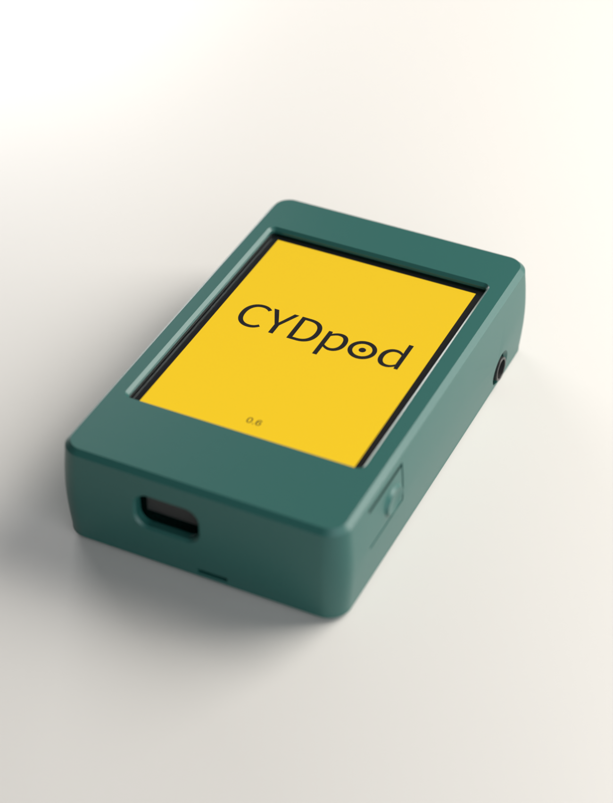

  <picture>
    <source media="(prefers-color-scheme: dark)" srcset="docs/assets/logo/cydpod-wordmark-reversed.svg">
    
  </picture>

<strong>Your music. Your player. No strings attached.</strong> 
A pocket music player you build yourself, from one cheap yellow display.

  <a href="https://github.com/nlpeeee/CYDpod/releases/tag/v0.6.0"><strong>Download CYDpod 0.6.0</strong></a>

  

  
  
   Rendered by the test harness, not photos of a device.

## Remember when music was simple?

You had a little player and a pocket full of songs. No subscription that could vanish your favourite album overnight, no ads between tracks, no app asking for your location. You pressed play, and it played.

CYDpod brings that back.

It starts with the Cheap Yellow Display, a tiny touchscreen computer that hobbyists love and that costs less than £20. Flash CYDpod onto it, slip in a memory card full of your music, and you have a player that's entirely yours: your whole collection, browsed the way it should be (by artist, album and song), streaming to your Bluetooth speaker or wired/wireless headphones.

## Why it's special

- **You own it.** No account, no cloud and no subscription. Nobody can take your music away, change the rules or track what you listen to.
- **It feels good to use.** Smooth, phone-like scrolling, a search that understands what you meant, and playlists that open the moment you tap them.
- **Make it sound your way.** A five-band equalizer with presets for bass, vocals, treble and loudness, tuned to stay clean even with every band turned up.
- **It respects your time.** Set it down and it quietly goes to sleep. Pick it up and it carries on exactly where you were.
- **It's made for tinkering.** Choose a theme, print the case, or dig into the code. It's your player, so make it yours.
- **Prefer wires?** Add a little DAC. a thumbnail-sized audio board (a PCM5102A-style I2S DAC ) plugs into its spare connector and gives you a proper line-out for a hi-fi, powered speakers or headphones. Choose Headphones in Settings → Audio Output, and the case has a version with room for the DAC inside.
- **It shouldn't be possible.** A board this small and this cheap was never meant to be a music player. Getting a full library, four audio formats and Bluetooth streaming onto it was fun.

  
  

## Make your own

You'll need a Cheap Yellow Display: the **JC2432W328C** (capacitive touch, and the only one with the wired-DAC option) or the generic **ESP32-2432S028R** (resistive touch). Each has its own download. You'll also need a **microSD card** with your music, a **Bluetooth speaker or headphones** (or the little DAC for wired listening), and a **Windows PC** for a few minutes.

1. [Download the latest release](https://github.com/nlpeeee/CYDpod/releases/tag/v0.6.0).
2. Follow the [flashing guide](docs/firmware/README.md).
3. Press play.

For the details, see the [firmware guide](docs/firmware/README.md) and the [release notes](docs/releases/0.6.0.md).

## Thanks

CYDpod stands on top of great work from:
- [CYD-MP3-Player](https://github.com/Garionhk/CYD-MP3-Player) by Garionhk, where it all started;
- MiniAAC;
- Helix MP3 (RealNetworks), via [arduino-libhelix](https://github.com/pschatzmann/arduino-libhelix);
- [miniflac](https://github.com/jprjr/miniflac) by John Regan;
- [ESP32-A2DP](https://github.com/pschatzmann/ESP32-A2DP) by Phil Schatzmann;
- [TFT_eSPI](https://github.com/Bodmer/TFT_eSPI) by Bodmer.

The firmware combines components under several licences, including GPLv3 and the Helix RPSL/RCSL. The full notices are in [vendor/NOTICES.md](vendor/NOTICES.md). CYDpod's own licence hasn't been chosen yet.

An independent hobby project, not affiliated with Apple. &ldquo;iPod&rdquo; is a trademark of Apple Inc.
