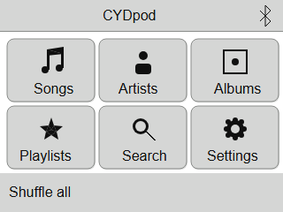
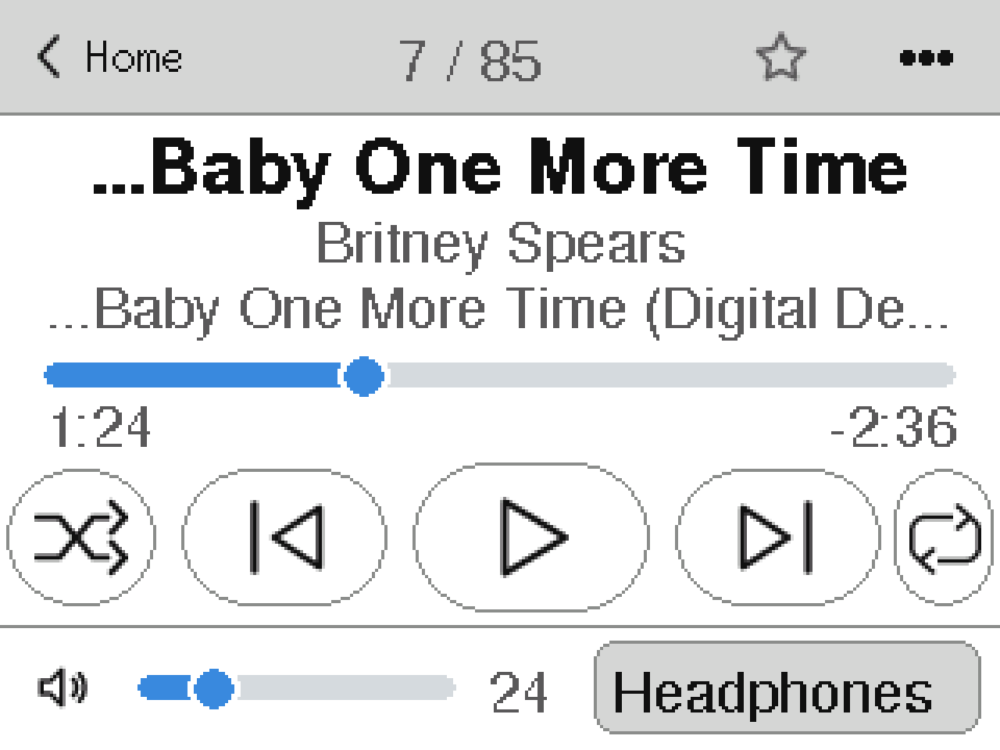
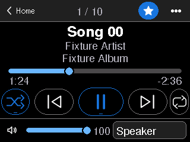
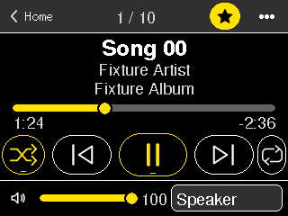
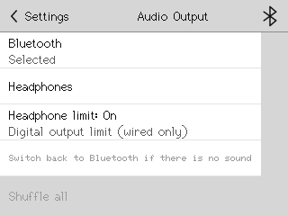

<p align="center">
  <picture>
    <source media="(prefers-color-scheme: dark)" srcset="docs/assets/logo/cydpod-wordmark-reversed.svg">
    
  </picture>
</p>

<p align="center"><strong>Up to ten thousand songs on a cheap yellow board.</strong><br>
An iPod-style music player for the JC2432W328C &ldquo;Cheap Yellow Display&rdquo;.</p>

<p align="center">
  <a href="https://OWNER.github.io/CYDpod/#flash"><strong>&#9654;&nbsp; Flash v<!--rel:version-->33<!--/rel--> from your browser</strong></a><br>
  <sub>Placeholder URL: replace <code>OWNER</code> (and the repo name if different) once the repo is published. Chrome or Edge, USB cable.</sub>
</p>

<p align="center">
  
  
  <br><sub>Simulator renders from the test harness, not photos of a device.</sub>
</p>

## What it is

CYDpod is open firmware that turns a very cheap ESP32 touchscreen board into a pocket music player. It reads music from a microSD card and shows it the classic way: Artist, Album, Song. Sound goes to a Bluetooth speaker or headphones, or out of a wired I2S output you add. No cloud service, no account; Wi-Fi is used only by an optional upload page.

## What you need

**Required**

- **A JC2432W328C board**: the 2.4&Prime; ESP32 &ldquo;Cheap Yellow Display&rdquo; with *capacitive* touch (ST7789 panel, CST820 touch), 4 MB flash, microSD slot. Other CYD variants (for example the resistive ESP32-2432S028R) are **not supported**.
- **A microSD card**: FAT32, 32 GB or smaller (the tested setup). Music in `/music` (sub-folders fine), playlists in `/playlists`. The player keeps its catalogue cache in `/.sys`.
- **A USB data cable and a computer with Chrome or Edge** (Web Serial; Firefox and Safari cannot flash).
- **An audio output.** *Bluetooth* speaker or headphones (pair in Settings &rsaquo; Bluetooth; **AirPods Pro 2 are not verified**). Or *wired*: an I2S DAC board on connector P6 (silkscreen: GND, IO16, IO4, IO17 = bit clock, data, word select), plus a headphone amplifier for headphones; a PCM5102A-class DAC is the documented example. Wired audio is **not yet verified on hardware**.

**Optional**

- A microSD card reader (the simplest way to copy music).
- An I2S DAC and headphone amplifier for the wired output.
- A phone or PC for the Wi-Fi upload page. It needs a separate uploader image that the single flash file does not include (see Known limits).

## What it can do

- **Formats:** MP3, FLAC (16-bit), M4A (AAC-LC), PCM WAV; other common sample rates are resampled to 44.1 kHz; HE-AAC is not supported.
- **Library:** built for 10,000 tracks (host-tested), cached on the card and validated quickly at boot.
- **Browse:** Artists, Albums, Songs, Folders, Favourites; Shuffle all on every list.
- **Search** with an on-screen keyboard; accents and case folded (&ldquo;beyonce&rdquo; finds Beyonc&eacute;).
- **M3U / M3U8 playlists** in `/playlists`, including playlists written for another folder layout (matched by path tail or file name).
- **Now Playing:** seek bar, volume, shuffle, repeat, favourite star; restores your last track, paused, at boot.
- **Themes:** Light, Black, High Contrast; portrait or landscape.
- **Phone-like scrolling:** drag, flick and coast, touch to stop, scroll thumb.
- **Bluetooth that behaves:** if your phone takes the speaker, the player does not page it back; discoverable only on the Pair screen.
- **Wired headphone limit:** switchable &minus;30 dBFS ceiling (off allows &minus;6 dBFS, much louder).
- **Wi-Fi upload page** (hotspot or your network, six-digit passcode, `000000` until changed): MP3s and playlists only; needs the uploader image.

<p>
  
  
  
</p>

## Why it is worth building

1. **Cheap hardware:** one small ESP32 board with a screen and card slot; no extra DAC for Bluetooth.
2. **No cloud, no account:** files stay on your card.
3. **Open firmware:** source, dependency pins and third-party notices are in this repo.
4. **Bounded memory:** one fixed 40 KB codec pool shared by all four decoders, so playback does not depend on library size.
5. **Host-tested:** catalogue, sorting, playlists, queue, scrolling, Bluetooth policy and output switching have automated tests; hardware results are labelled separately.
6. **Flash from the browser:** no toolchain.

## Flash it

Version <!--rel:version-->33<!--/rel-->, 4 MB image, SHA256 `<!--rel:sha256-->333b5fc005416167a634adf40588b1e6a51b5a746ecf69fad36a30156b23dc3b<!--/rel-->`.

1. Plug the board into your computer.
2. Open the site (placeholder link above) in Chrome or Edge and click **Install**.
3. Choose the serial port (CP210x, CH340 or USB Serial) and confirm.
4. Wait for the progress bar to finish; press RESET if the board does not restart.

> **The one-click flash erases saved settings** (Bluetooth speaker, volume, theme, brightness, Wi-Fi, last track): it writes the whole flash from offset 0. The SD card is untouched. To keep settings, use the four-region flash below.

**Will not enter download mode?** Hold BOOT, tap RESET, release BOOT. No port? Use a data cable and install the CP210x or CH340 driver your board needs.

**Keep settings (four regions, esptool 5.x):** with the four files from `docs/firmware/regions/` in one folder:

```powershell
esptool --chip esp32 --port COM7 --baud 460800 --before no-reset --after no-reset write-flash --flash-mode dio --flash-freq 80m --flash-size 4MB 0x1000 app.ino.bootloader.bin 0x8000 app.ino.partitions.bin 0xe000 boot_app0.bin 0x10000 app.ino.bin
```

**Single file from the command line (erases settings):**

```powershell
esptool --chip esp32 --port COM7 --baud 460800 --before no-reset --after no-reset write-flash --flash-mode dio --flash-freq 80m --flash-size 4MB 0x0 <!--rel:file-->cydpod-v33-w328c.bin<!--/rel-->
```

**Verify the file:** `Get-FileHash .\<!--rel:file-->cydpod-v33-w328c.bin<!--/rel--> -Algorithm SHA256` (Windows), `shasum -a 256 <!--rel:file-->cydpod-v33-w328c.bin<!--/rel-->` (macOS), `sha256sum <!--rel:file-->cydpod-v33-w328c.bin<!--/rel-->` (Linux).

The release folder is described in [docs/firmware/README.md](docs/firmware/README.md); the page and manifest are produced by `tools/make_site_release.ps1`.

## Known limits

- **Not in this build:** the boot-loop fix after a crash; sleep-timer arming (the setting exists); album artwork.
- **Wi-Fi upload** needs a separate uploader image, which the single flash file leaves blank (&ldquo;Uploader not installed&rdquo;); the page accepts MP3 and playlist names only.
- **Not yet checked on a real board:** AirPods Pro 2; wired I2S output; the time to scan 10,000 tracks the first time (model estimate about 11 minutes, range 6 to 16, not measured) and to boot afterwards; flick feel, memory headroom, battery life; the one-click flash itself.

Evidence and the owner checklist: [docs/research/int4-integration.md](docs/research/int4-integration.md), [docs/research/int4-checklist.md](docs/research/int4-checklist.md).

## Build from source

Windows with Python and PowerShell. Setup downloads pinned dependencies into the checkout; the check compiles everything and never touches a device.

```powershell
powershell -File tools/setup.ps1
powershell -File tools/check.ps1 -Board jc2432w328c
```

Images and a manifest land in ignored `.tools/images/`. Read the [player specification](docs/specs/cydpod-plan.md), the [implementation checkpoint](docs/IMPLEMENTATION_STATUS.md) and the [research reports](docs/research/) before changing anything. Dependency versions and hashes: [dependencies.lock.json](dependencies.lock.json).

## Licences

Full notices: [vendor/NOTICES.md](vendor/NOTICES.md) and [vendor/notices/](vendor/notices/). The combined firmware binary is **not** labelled Apache or MIT: GPLv3 components and the Helix RPSL/RCSL terms apply, and codec patent questions are separate.

| Component | Licence |
| --- | --- |
| CYD-MP3-Player (application shell) | Apache-2.0 |
| AnimatedGIF (BitBank) | Apache-2.0 |
| ESP32-A2DP | Apache-2.0 |
| arduino-libhelix / Helix MP3 | GPLv3 wrapper, RealNetworks RPSL/RCSL codec |
| MiniAAC | MIT wrapper; Helix AAC core under GPLv3 / RPSL / RCSL |
| miniflac | 0BSD |
| TFT_eSPI | BSD two-clause (MIT ancestry, font notices kept) |
| arduino-audio-tools | GPLv3 (vendored, not wired into the build) |
| Arduino-ESP32 / ESP-IDF | LGPL-2.1 and Espressif/third-party notices |

CYDpod's own licence has not been chosen yet.

## Credits

[CYD-MP3-Player](https://github.com/Garionhk/CYD-MP3-Player) by Garionhk (the starting point); MiniAAC; Helix MP3 (RealNetworks) via [arduino-libhelix](https://github.com/pschatzmann/arduino-libhelix); [miniflac](https://github.com/jprjr/miniflac) by John Regan; [ESP32-A2DP](https://github.com/pschatzmann/ESP32-A2DP) by Phil Schatzmann; [TFT_eSPI](https://github.com/Bodmer/TFT_eSPI) by Bodmer; [ESP Web Tools](https://esphome.github.io/esp-web-tools/) by ESPHome for the browser flasher; type: Source Sans 3 and IBM Plex Mono (SIL OFL).

<sub>Independent hobby project, not affiliated with Apple. &ldquo;iPod&rdquo; is a trademark of Apple Inc.</sub>
