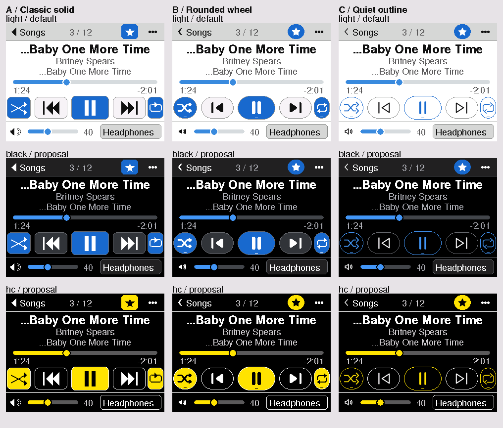

# CY-87: three icon and button options

2026-11-05. Design exploration based on accepted v23, `10416be`, on branch
`cydpod/icon-options` in `E:\dev\.worktrees\CYDpod\cy87-icon-options`.
The prior session left two unfinished generator fragments; this continuation
completed the generator, previews, cost model and report. Firmware, tests and
geometry goldens are unchanged. No device, serial, flash or SD operation occurred.

**Recommend B, Rounded wheel**, subject to the owner's visual choice and later
panel/playback qualification. Its filled symbols and rounded faces work together
at transport size, its outlined/filled favourite states are distinct, and its
1-bit masks are substantially smaller than C's alpha masks. The proposed renderer
must stream each complete button through one window; simply drawing more rounded
primitives would increase window calls.



## Open the previews

Each sheet includes all 17 enum icons plus favourite-off, nine nominal sizes,
normal/pressed/active/repeat-one transport rows, portrait cells and star states.
All enlargements use nearest-neighbour replication of native RGB565 pixels.

| Option | Light sheet: native / 4x | Now Playing: native / 4x |
| --- | --- | --- |
| A: Classic solid | [native](cy87-icon-options/a-sheet-light.png) / [4x](cy87-icon-options/a-sheet-light-x4.png) | [320x240](cy87-icon-options/a-player-light.png) / [4x](cy87-icon-options/a-player-light-x4.png) |
| B: Rounded wheel | [native](cy87-icon-options/b-sheet-light.png) / [4x](cy87-icon-options/b-sheet-light-x4.png) | [320x240](cy87-icon-options/b-player-light.png) / [4x](cy87-icon-options/b-player-light-x4.png) |
| C: Quiet outline | [native](cy87-icon-options/c-sheet-light.png) / [4x](cy87-icon-options/c-sheet-light-x4.png) | [320x240](cy87-icon-options/c-player-light.png) / [4x](cy87-icon-options/c-player-light-x4.png) |
| Current v23 reference | [native](cy87-icon-options/current-sheet-light.png) / [4x](cy87-icon-options/current-sheet-light-x4.png) | [320x240](cy87-icon-options/current-player-light.png) / [4x](cy87-icon-options/current-player-light-x4.png) |

| Option | Black proposal | High-contrast proposal | Portrait light |
| --- | --- | --- | --- |
| A | [sheet](cy87-icon-options/a-sheet-black.png), [screen](cy87-icon-options/a-player-black.png) | [sheet](cy87-icon-options/a-sheet-hc.png), [screen](cy87-icon-options/a-player-hc.png) | [240x320](cy87-icon-options/a-portrait-light.png) |
| B | [sheet](cy87-icon-options/b-sheet-black.png), [screen](cy87-icon-options/b-player-black.png) | [sheet](cy87-icon-options/b-sheet-hc.png), [screen](cy87-icon-options/b-player-hc.png) | [240x320](cy87-icon-options/b-portrait-light.png) |
| C | [sheet](cy87-icon-options/c-sheet-black.png), [screen](cy87-icon-options/c-player-black.png) | [sheet](cy87-icon-options/c-sheet-hc.png), [screen](cy87-icon-options/c-player-hc.png) | [240x320](cy87-icon-options/c-portrait-light.png) |

Every linked dark/contrast/portrait image also has a `-x4.png` companion. The
[48-file manifest and generated measurements](cy87-icon-options/metrics.json)
enumerate every PNG. [Comparison at 4x](cy87-icon-options/comparison-x4.png).

## Sizes and geometry taken from the code

Sources: `classic_layout.h`, `classic_screen.cpp::playerButton/playerTransport`,
`ui.cpp::ui_icon/ui_button/ui_iconToggle`, `tokens.h` and `style.h` at the base.

| Use | Actual nominal `ui_icon` size |
| --- | ---: |
| Browse row chevron/current-track play | 12 px |
| Paging up/down; legacy shared header Back | 14 px |
| Classic header Back; Player volume speaker | 16 px |
| Favourite (`ICON_MD`); browse mini-player play/next | 18 px |
| Browse header Bluetooth/headphones route | 24 px |
| Home note/star/gear | 28 px |
| Landscape shuffle / previous / play-pause / next / repeat | 32 / 32 / 34 / 32 / 25 px |
| Portrait shuffle / previous / play-pause / next / repeat | 25 / 25 / 34 / 25 / 25 px |

The expanded-cell detail matters: `playerButton` calls `ui_button` with the cell
expanded by 3 px on each side and clipped back to the original rectangle. Thus
the glyph field is `min(w+6,h+6)*3/5`, not `min(w,h)*3/5`. For example the 80x52
play target has a 34 px field. All options use these same nominal fields; B/C
reserve optical padding inside them. Sheets include all nine sizes, even where a
particular glyph/size combination is not used, to expose small-size limitations.

Landscape hit/paint cells remain `(0,148,52,48)`, `(56,148,70,48)`,
`(130,146,80,52)`, `(214,148,70,48)`, `(284,148,36,48)` in control order.
Portrait remains `(0,228,36,48)`, `(40,228,36,48)`, `(80,226,80,52)`,
`(164,228,36,48)`, `(204,228,36,48)`. Existing 36 px narrow targets are retained;
this design does not claim to have increased them to 44 px. Back is 100x40,
favourite 40x40 and options 48x40. New faces inset 2 px inside transport cells;
the complete original rectangle continues to own touch input. Neither landscape
rotation requires mirrored glyphs or different geometry. Portrait previews use
the actual separate layout; no image scaling is used to simulate portrait.

## The three design languages

**A / Classic solid — primitive draws.** Sharp filled play/back/up/down triangles,
double-triangle skips with an end bar, square pause bars, an outlined off-star
and filled on-star. Flat filled faces have 8 px corners, a 1 px edge and no top
highlight. Pauses use bars about 22% of the nominal field; Bluetooth doubles its
lines to 2 px; headphones use a 2 px minimum band; solid symbols use most of the
field. Gear/note/shuffle/repeat retain the v23 primitive family. That reduces the
implementation change, but also retains some of its inconsistent optical weight:
repeat and gear are busier than the triangles. Normal is dark-on-raised,
pressed is white-on-pressed-blue, active is white-on-deep-blue. This is the
strongest old-iPod transport reference and the least ambitious overall refresh.

**B / Rounded wheel — packed 1-bit masks.** Filled rounded play/skip triangles,
capsule pause bars, rounded headphones and a clear chevron Back. Stroke width is
`max(2,0.095*s)` px in the offline outlines; triangle rounding is about 8.5% of
the field. Play occupies about 66% width and 78% height; pause spans 76% height;
skip uses a single triangle plus an end bar to stay clean at 25 px. The favourite
has separate hollow and solid silhouettes. Transport faces are rounded to half
their shorter dimension, inset 2 px: broad pills at centre/skip, narrow capsules
at the ends. Normal/pressed/active use the same palette roles as A; active adds
a short 6 px underline so state has a shape cue as well as colour. Repeat has
two separated return paths and visible opposing arrowheads; the initial closed
loop was revised because it read as an empty box at 25 px. These are touchscreen
buttons inspired by a wheel's rounded vocabulary; no wheel interaction is added.

**C / Quiet outline — packed 4-bit coverage masks.** Open play/skip triangles,
thin chevrons, outlined speaker/music symbols, light gear and a two-arrow repeat.
Stroke width is `clamp(0.06*s,1.5,2.1)` px; pause bars are thicker for recognition.
Play and skip deliberately become filled at 12/14 px because an outline triangle
loses its counter there. The favourite remains filled when on. Faces use B's
geometry with a hairline border and the page background inside. Press fills the
face; active uses an accent border/glyph plus the underline rather than a solid
face. It gives the text more visual prominence, especially on black, at the cost
of weaker small glyphs and more data/blending work.

All three cover PREV, PLAY, PAUSE, NEXT, GEAR, BLUETOOTH, BACK, NOTE, SHUFFLE,
REPEAT, REPEAT_ONE, UP, DOWN, CHEVRON, SPEAKER, STAR and HEADPHONES. SPEAKER remains
the volume symbol only; there is no new Speaker output. The output chip retains
its full CY-85 width and text-only treatment.

## Palettes, text fidelity and native-size limits

Light values are copied from `theme.cpp` verbatim. Black and high contrast are
illustrative CY-76 proposal-G role tables, not shipped themes. Black uses pure
black, visible grey faces and blue activation. High contrast uses black, white
edges and yellow activation with black active ink. No gradient or shadow is
required. Full-coverage icon contrast in light is 17.32:1 normal, 5.32:1 active
and 3.52:1 pressed; black is 12.49/5.32/3.52; high contrast 21/16.24/21. C's
partially covered edge pixels naturally have less contrast than its core.

Track title, compact title, artist, album, times, queue count, volume and output
chip use the actual installed FreeSans/FreeSansBold 9/12 pt bitmaps and the
cap-height baseline/whole-glyph fitting rules from CY-85. Nothing is drawn with
a host system font. The small header parent label uses the same FreeSans Label
face for this mock; firmware uses TFT font 2 there. Accordingly these are layout
mocks with faithful CY-85 content text, not captures of the production screen.

A's diagonal stair steps and thin inherited repeat detail are evident at native
size. B's 12/14 px gear, speaker waves and repeat-one are crowded; repeated-arrow
detail is much clearer at its actual 25 px use. Hollow stars are distinguishable
from filled stars at their 18 px header size. C looks most refined enlarged:
its 12/14 px music/gear/repeat details and fractional edge coverage are the weakest
at native size. Do not choose it from the 4x sheet alone. Neither monitor pixels
nor a PNG establish panel gamma, backlight/viewing-angle legibility or physical
touch comfort. No panel or Bluetooth success is claimed.

## Flash, RAM and draw cost

The conservative catalogue has 18 states x 9 sizes = 162 records, without mirror
deduplication or pruning unused combinations. B is row-aligned 1-bit data; C is
row-aligned 4-bit coverage. Each record reserves 12 B for offset/dimensions/optical
origin/stride metadata, including alignment. Packing/unpacking is checked for
every sample. These are exact data counts for the proposed formats, not a linked
firmware size measurement.

| Option | Packed masks | Metadata | Whole catalogue | Additional renderer code estimate |
| --- | ---: | ---: | ---: | --- |
| Current | 0 B | 0 B | primitive code | existing; historical CY-76 `ui_icon` symbol 2,207 B |
| A | 0 B | 0 B | primitive code | roughly 0.5–1.5 KB net over current; verify by linking |
| B | 8,456 B | 1,944 B | **10,400 B** | roughly 1–2 KB for lookup, face spans and row streaming |
| C | 30,469 B | 1,944 B | **32,413 B** | roughly 1–3 KB including integer coverage blending |

For comparison, precoloured RGB565 glyphs alone would occupy 117,450 B for B or
120,366 B for C **per foreground/background pair**. Masks can reuse the same data
across themes and states. Future linking can remove unused primitive cases; no
such saving is assumed above. This preview-only change adds **0 B firmware flash,
0 B static RAM and 0 B persistent heap**, because no firmware source changed.

For implementation, use a bounded local RGB565 row buffer: 76 B maximum for a
standalone B glyph (68 B for C), or **160 B on the UI stack** for an 80 px button
cell. C additionally needs a 16-entry RGB565 blend table (32 B on the stack),
computed once per foreground/background pair. Allocate no sprite, framebuffer,
heap cache or persistent scratch array. Rounded face scanline endpoints can be
computed as integer spans or stored in flash; overlays are composed in RAM.

The model counts an address window as 11 command/address bytes and each RGB565
pixel as 2 bytes. At 40 MHz, bytes x 0.2 microseconds is only a wire-time floor.
Driver address caching, transaction overhead, CPU rasterisation, task scheduling
and SD/Bluetooth contention are excluded. `ui_icon`/TFT primitive ports provide a
comparison model, not a measured trace of every driver optimisation.

| Redraw workload | Current windows / bytes | A windows / bytes | B windows / bytes | C windows / bytes |
| --- | ---: | ---: | ---: | ---: |
| All 162 standalone glyphs, once | 6,761 / 153,953 | 7,643 / 171,479 | 162 / 119,232 | 162 / 122,148 |
| Five transport cells, normal | 474 / 71,808 | 581 / 68,477 | 5 / 30,263 | 5 / 30,263 |
| Five transport cells, active | 438 / 71,314 | 548 / 68,084 | 5 / 30,263 | 5 / 30,263 |

B/C transport figures **assume one composite window per entire button**, including
background clear, face, glyph and state marker. The generator models that stream;
it does not implement a firmware blitter. An active row's wire floor is 14.263 ms
current, 13.617 ms A, 6.053 ms B/C. This is about 58% fewer modelled bytes for
B/C, not proof of a 58% speedup. Identical B/C wire counts do not imply identical
CPU cost. Retaining primitive rounded faces would still require about 548 windows
for B's row and forfeit most of the command-count benefit. A already increases
window count despite slightly fewer row bytes, so it is not a stutter fix.

Use `startWrite`, one `setAddrWindow` and row bursts through `pushColors` (or a
suitable opaque `pushImage` path), then `endWrite`. Do not call `drawPixel` over
SPI for each mask bit and do not open a new window per row. Standalone glyphs
must also use a single clipped window with the supplied flat background colour.
Only changed controls repaint; leave the one-dirty-row/ring-health policy and
time-band repaint schedule unchanged. Audible breakup still requires measured
buffer/underrun and listening evidence after implementation.

## Proposed implementation chunk, after visual selection

1. Keep `classic_layout.h` and all touch rectangles unchanged. Generate selected
   B mask data into a small flash-only `ui_icons.h`/`.cpp` pair from this tool;
   retain source attribution. No Python or outline rasteriser ships on-device.
2. Add a bounded, clipped single-window glyph/whole-control row renderer in
   `ui.cpp`; reuse the existing TFT_eSPI primitives and driver transaction API.
   Retain public `ui_icon`/`ui_button`/`ui_iconToggle` interfaces where practical;
   make favourite-off distinct. Handle the expanded/clipped Player cell wrapper
   explicitly in `classic_screen.cpp` so it does not resize or double-inset faces.
3. Extend the existing host recorder/tests at implementation time for all enum
   icons, mask decoding, viewport clipping, normal/pressed/on/off/repeat-one and
   unchanged geometry/hit targets in rotations 0/1/2/3. Check window counts using
   the actual blitter. No geometry golden update is expected.
4. Run both repository checks sequentially; report exact linked flash/static RAM
   deltas and codec pool size. Later, on identified hardware, compare idle and
   active UI `stat: buf`/underruns, rapid transport taps, long Bluetooth playback
   and small glyph visibility. Device work needs its own authorised task.

## Reproduction and validation

Run from this worktree, using only already installed pinned dependencies:

```powershell
python -I tools/cy87_icon_sets.py
# If the installed dependency tree is elsewhere:
python -I tools/cy87_icon_sets.py --fonts E:\dev\CYDpod\.deps\sketchbook\libraries\TFT_eSPI\Fonts\GFXFF
```

The default output is `docs/research/cy87-icon-options/`; `--out` can redirect it.
No downloads or new dependencies are required. The generator validates PNG
signature, every chunk CRC, RGB format and complete decompression/dimensions for
all 48 files; checks nonempty bitmap glyphs and packed-mask round trips; emits
`metrics.json`. Validation output is retained in `.tools/logs/cy87-previews.log`:

```text
PASS CY87_PREVIEWS: 48 PNGs; signature, CRC, RGB format and decompressed dimensions verified
PASS CY87_CATALOGUE: 18 glyph states x 9 sizes x 4 styles; all masks nonempty
PASS CY87_PACKING: all 1-bit and 4-bit mask samples round-trip without loss
```

Native light sheets, the three-theme comparison, portrait controls and enlarged
B controls were opened and visually inspected. Primitive drawing routines are
Python ports from the installed TFT_eSPI 2.5.43; its full upstream notice is
retained in the script. Fonts are read from installed headers, never downloaded
or copied into this repo. Their existing GFXFF notices/provenance remain intact.
New icon outlines are defined in the generator; no external icon pack was used.

Two independent generator runs produced **49 byte-identical files** (48 PNGs
plus metrics). All 34 local artifact links in this report resolve. The staged
diff passes `git diff --cached --check`.

Repository checks ran sequentially in this worktree with the installed `.deps`
junction and private `.tools` config/cache/build directories:

- `powershell -NoProfile -File tools/check.ps1` — **exit 0**;
  `.tools/logs/cy87-check-default.log`. Includes both UI host runs, geometry in
  all four rotations, the 282-glyph/585-fit CY-85 checks, codec and media suites.
- `powershell -NoProfile -File tools/check.ps1 -Board jc2432w328c -SkipProbe -SkipHostMedia`
  — **exit 0**; `.tools/logs/cy87-check-w328c.log`. Normal/wired player, both tone
  variants and diagnostic compiled; both players retain one 40,960 B codec pool.

Retained command output:

```text
DEFAULT_CHECK_EXIT=0
PASS synthetic fixture matrix: 3 positive, 7 negative; report fixtures/verification.json
PASS: compile-only checks completed; no device commands were run.
W328C_CHECK_EXIT=0
PASS single pool: 3ffc4a40 0000a000 b _ZN12_GLOBAL__N_1L9codecPoolE
PASS: compile-only checks completed; no device commands were run.
```

Maintained default player: 1,460,393 B program / 91,056 B static RAM. W328C normal:
1,497,669 B / 92,632 B, matching the CY-85 recorded baseline. These builds validate
the unchanged base; no new firmware version/tag was reserved or published.
Review the PNG options before starting the separate implementation chunk.
