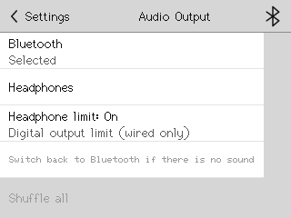

# CY-92 wired Headphone limit

Base 557f2b4; firmware 1db5042; `cydpod/headphone-limit`.

## Change

Settings > Audio Output has **Headphone limit: On / Off** under either route. Tolerant release toggles once; cancellation does nothing. Commit `hpLimit` first; failure reports an error and retains displayed/applied/saved choice. Absent/invalid defaults On, including forced-wired.

On = Q15 4125 (-18.00052 dBFS); Off = 16423 (-5.99995 dBFS analogue headroom): 12.00057 dB difference. Digital gain limit, not a compressor or calibrated hearing-safety/SPL guarantee. Shared slider/curve, Bluetooth and I2S are unchanged.

ESP32 portMUX protects a latest-value mailbox for one load/store (UI request or once/writer chunk); only the writer changes Fade. Startup resets to the selected ceiling before nonzero PCM. Live slew: 1 Q15/frame, 12,298 frames = 278.866 ms at 44.1 kHz; reversals continue from current gain. Downward reaches On after settling, plus one normal 256-frame observation and existing DMA latency. L/R share the existing multiply; worst product plus rounding 538,165,248 fits int32. Silence, hold/drain, mute, parking and failure paths remain.

Landscape limit row (0,116,290,40), hint y116 -> y156. Same dirty-row budget, one extra row, no periodic draws; audio health reasoned, not measured.



## Focused evidence

- g++ wired_fade/wired_pump: exit 0, `WIRED_FADE_OK`, `WIRED_PUMP_OK`; startup/PCM, both legs/reversal. `.tools/logs/cy92-fade.log`.
- g++ settings_route, plain/wired/forced: exit 0, three `SETTINGS_ROUTE_OK`; defaults/persistence/save failure. `.tools/logs/cy92-settings.log`.
- `cmd /c .tools/cy92_ui.cmd`: exit 0, `PASS CY-92 UI`; release/cancel/failure/route, PNG, CY-91 Theme spot check. `.tools/logs/cy92-ui.log`.
- `powershell -NoProfile -File tools/check.ps1 -SkipProbe -SkipHostMedia`: exit 0, `PASS: compile-only checks completed`.
- Add `-Board jc2432w328c`: exit 0, `PASS: compile-only checks completed`. Logs `.tools/logs/cy92-default.log`, `cy92-jc.log`.

JC atomic guard failed; portMUX fix passed. Evidence: `.tools/logs/cy92-mailbox-guard-failure.log`. Default excludes wired.cpp.

Bytes versus CY-91 (flash / static / app image; deltas):

| Target | Flash | Static | Image |
|---|---:|---:|---:|
| Default | 1489293 (+60) | 91080 (+0) | 1489440 (+64) |
| W328C | 1530553 (+652) | 92672 (+16) | 1530704 (+656) |
| Forced wired | 1530697 (+664) | 92672 (+16) | 1530848 (+672) |

Fade 676->680 B; Work 1700->1704 B (+4 in the existing allocation, no new blocks/buffers). Settings stays 320 B. Mailbox/lock = 4+8 B; linked alignment adds 4 B. Codec pool stays 40,960 B.

`.tools/images/codec-pool-v26-jc2432w328c`: `PASS V26_EXPORT`, seven normal-file sizes/SHA256, four offsets; list `.tools/logs/cy92-export.log` and image manifest. Companion: `codec-pool-v26-wired-jc2432w328c`.

## Owner only

No device/serial/flash/SD/media operations. Owner tests: loudness, panel quality, playback stability; toggle while playing, reboot both values, switch BT/Headphones, check themes and pause/seek/track transitions. CY-68 stays paused.

Identify W328C as COM7; enter manual download mode (hold BOOT, tap RESET, release BOOT). Keep factory backup; rollback image is `E:/dev/.worktrees/CYDpod/cy72-bt-gating/.tools/images/codec-pool-v8-jc2432w328c`. Owner commands, not run:

```powershell
Set-Location E:\dev\.worktrees\CYDpod\cy92-headphone-limit
$img = '.tools/images/codec-pool-v26-jc2432w328c'
$tool = '.\.deps\arduino\packages\esp32\tools\esptool_py\5.3.0\esptool.exe'
foreach ($op in @('write-flash','verify-flash')) {
  & $tool --chip esp32 --port COM7 --baud 460800 --before no-reset --after no-reset $op --flash-mode dio --flash-freq 80m --flash-size 4MB 0x1000 "$img/app.ino.bootloader.bin" 0x8000 "$img/app.ino.partitions.bin" 0xe000 "$img/boot_app0.bin" 0x10000 "$img/app.ino.bin"
}
```
Press RESET afterwards; restore with the same commands and `$img` set to v8.
